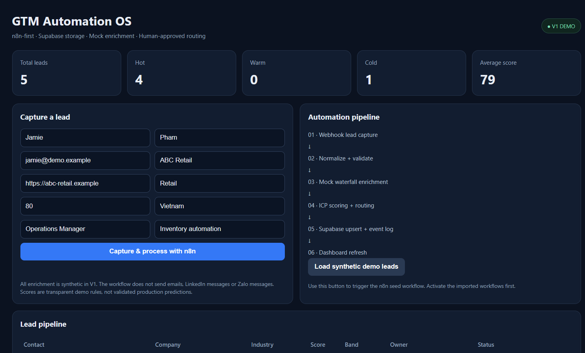
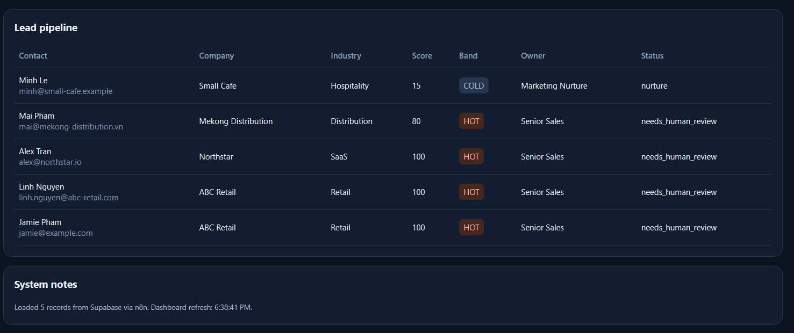
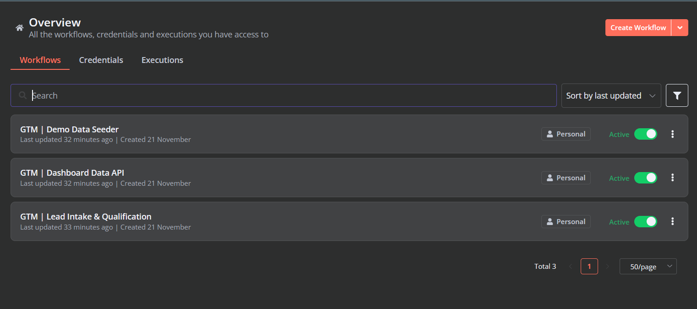
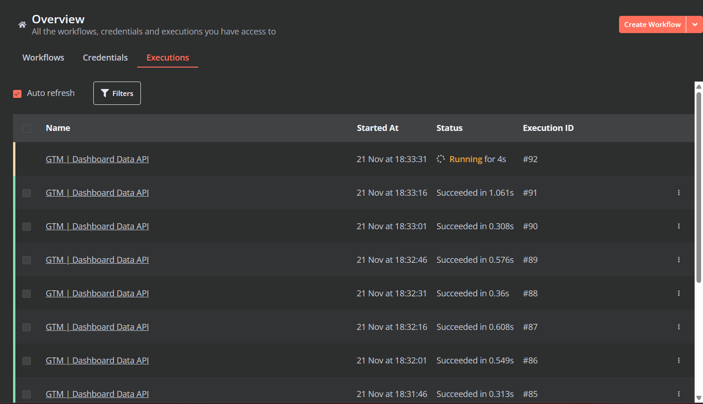
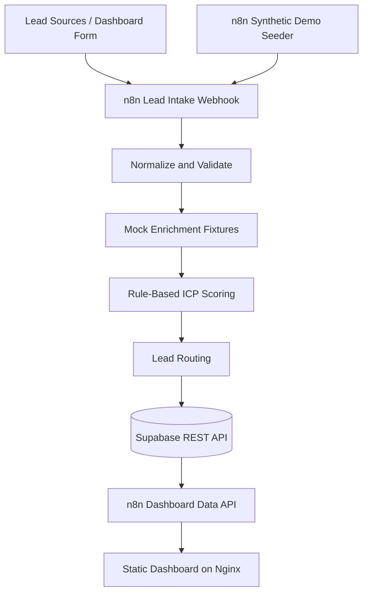

# GTM Automation OS V1

A portfolio-grade, local-first lead intake and qualification prototype built with n8n, Supabase, Docker Compose, and a static Nginx dashboard. V1 demonstrates workflow orchestration, API integration, database design, lead routing, and auditable rule-based decisions using synthetic data.

> **Scope:** This is a demonstration, not a production-ready or multi-tenant sales system. All provider integrations are mocked or reserved; V1 does not call paid APIs or send outbound messages.

## Business problem

Inbound and manually sourced leads often arrive in inconsistent formats and are assessed with ad hoc rules. This prototype demonstrates a repeatable flow that normalizes lead submissions, applies transparent qualification rules, assigns a follow-up route, persists the result, and exposes local dashboard metrics.

## Screenshots

### Dashboard Overview

The main dashboard provides an at-a-glance view of lead qualification metrics, lead capture, and the automation pipeline.



### Lead Pipeline

The lead pipeline displays qualification scores, lead categories, assigned owners, and processing status.



### n8n Workflow Management

The V1 implementation consists of three workflows for lead intake, dashboard data retrieval, and synthetic demo data generation.



### Workflow Execution

n8n execution history provides visibility into workflow runs and their execution status.



## Implemented in V1

- n8n workflow orchestration and HTTP webhooks.
- Lead validation and normalization.
- Mock enrichment from local fixtures; no enrichment provider is contacted.
- Deterministic ICP score, score band, and routing owner.
- Supabase REST persistence for leads and processing events.
- Dashboard data API and static dashboard served by Nginx.
- Synthetic demo lead generation.

## Architecture



See [Architecture](docs/architecture.md) for boundaries and future integration seams.

## Technology stack

- **Orchestration:** n8n (`n8nio/n8n:1.82.3` in the supplied Compose file).
- **Database and REST API:** Supabase Postgres/PostgREST.
- **Web UI:** Static HTML/CSS/JavaScript served by Nginx.
- **Local deployment:** Docker Compose with persistent n8n data volume.
- **Workflow payloads:** JSON; scoring logic uses JavaScript in n8n Code nodes.

## Workflows

| Workflow | Responsibility | State in repository |
|---|---|---|
| WF01 Lead Intake | Receives a lead, normalizes fields, applies fixture enrichment and ICP scoring, routes, upserts the lead, logs an event, and responds. | Inactive JSON export; import and activate manually after configuration review. |
| WF02 Dashboard API | Reads lead rows from Supabase and returns dashboard metrics and lead data. | Inactive JSON export; import and activate manually after configuration review. |
| WF03 Demo Data Seeder | Generates synthetic records and posts them to WF01 over the Compose network. | Inactive JSON export; import and activate manually after configuration review. |

The exports use the environment names `SUPABASE_URL` and `SUPABASE_SECRET_KEY`. WF01/02 send the Secret API key in the `apikey` header. Keep n8n private because its workflows can access that server-side credential.

## Database overview

`supabase/schema.sql` defines:

- `public.leads`: contact and company attributes, enrichment metadata, score, score band, reasons, owner, status, AI placeholder fields, approval flag, and timestamps.
- `public.events`: lead email, event type, detail, and timestamp.
- Indexes for score band, ownership, and timestamps; row-level security is enabled on both tables.

The schema file is a setup reference. Review it and apply it manually in the Supabase SQL Editor if the tables do not already exist. Do not apply schema changes to an existing project without reviewing the impact.

## Requirements

- Docker Engine/Desktop with Docker Compose.
- A Supabase project with the `leads` and `events` tables created from `supabase/schema.sql`.
- A Supabase Project URL and an appropriate server-side Secret API key.

## Configure Supabase and local environment

1. Copy `.env.example` to `.env`.
2. Set `SUPABASE_URL`, `SUPABASE_SECRET_KEY`, and a unique long `N8N_ENCRYPTION_KEY` in `.env`.
3. Confirm the URL and key belong to the same Supabase project. Keep the Secret key on the server side; never put it in dashboard code, workflow literals, screenshots, or Git.
4. `.env` is excluded by `.gitignore`. Do not commit it.
5. If setting up a new Supabase project, review `supabase/schema.sql` and execute it yourself in the Supabase SQL Editor.

## Start locally

From the repository root:

```bash
docker compose config --quiet
docker compose pull
docker compose up -d --pull always
docker compose ps
```

Compose publishes n8n at `http://localhost:5679` and the dashboard at `http://localhost:8080`; n8n listens on port 5678 inside its container. The dashboard and n8n ports are bound to loopback. The n8n database/configuration is persisted in the named `n8n_data` volume.

Create the n8n owner account on first access. Before using this with real data, harden authentication and restrict access.

## Import workflows

1. Open `http://localhost:5679` and sign in to the local n8n instance.
2. Import the three JSON exports from `workflows/`: `WF01_lead_intake.json`, `WF02_dashboard_api.json`, and `WF03_demo_data_seeder.json`.
3. Review node settings, environment expressions, webhook paths, and Supabase request nodes.
4. Save and activate workflows only after verifying configuration and access controls.

Webhook routes after activation:

- `POST http://localhost:5679/webhook/gtm-lead-intake`
- `GET http://localhost:5679/webhook/gtm-dashboard-data`
- `POST http://localhost:5679/webhook/gtm-seed-demo`

## Dashboard and demo

Open `http://localhost:8080`. Use the form to submit a synthetic lead, or use the demo seed button after WF01, WF02, and WF03 have been imported, reviewed, and activated. The dashboard reads data through WF02; it does not access Supabase credentials directly.

A synthetic payload is available in `sample-data/synthetic_leads.json`. The seed workflow uses its own embedded synthetic fixture list and posts records to the intake webhook. Demo records are inserted/upserted into the configured Supabase database when the workflows run; use a disposable project or obtain approval before doing so.

## ICP scoring and routing

The implemented heuristic awards points for target industry (+20), company size from 20 to 500 (+20), target geography (+15), decision-maker title (+20), and relevant business need (+25). Bands route to Senior Sales (75–100), Sales Development (50–74), or Marketing Nurture (0–49). This is a transparent demonstration heuristic, not a validated predictive model.

## Security considerations

- Keep `.env`, Supabase Secret API keys, and the n8n encryption key out of Git and browser code.
- Rotate credentials if they were ever committed, shared, or included in a screenshot/log.
- Restrict who can access or edit n8n workflows: V1 enables `$env` access in Code nodes so HTTP request nodes can read Supabase credentials.
- The dashboard and webhook endpoints do not implement user authentication or webhook signatures. Keep the stack local and do not expose it publicly as-is.
- Use synthetic records only for demonstrations; do not load real prospect data without authorization, consent, and retention controls.
- Review Compose image tags and update them deliberately; back up the n8n volume and protect the encryption key.

## Known limitations

- Enrichment is fixture-based; no Clay, Apollo, or other provider is called.
- Scoring is deterministic and not trained or calibrated.
- V1 has no CRM sync, multi-source connectors, AI qualification, authentication layer, rate limiting, retry/dead-letter strategy, or production monitoring/alerting.
- Webhook and dashboard access is intended for local demonstration, not public deployment.
- Workflows are exported inactive and must be imported and reviewed in n8n.

## V2 roadmap (planned, not implemented)

- Apollo API integration and Clay enrichment integration.
- HubSpot and Salesforce synchronization.
- Real multi-source lead ingestion and company intent signals.
- AI-assisted lead qualification with constrained output and human review.
- Production monitoring, retries, error handling, and operational alerting.

See [Roadmap](docs/roadmap-v2.md) for scope boundaries. No V2 feature should be inferred from the placeholders in V1.

## Repository documentation

- [Architecture](docs/architecture.md)
- [Data model](docs/data-model.md)
- [Technical decisions](docs/technical-decisions.md)
- [Testing results](docs/testing-results.md)
- [V2 roadmap](docs/roadmap-v2.md)
- [Six-minute demo script](docs/demo-script.md)
