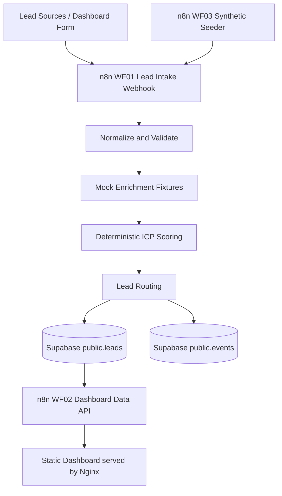

# Architecture

## Implemented V1 flow

The dashboard sends lead submissions to WF01 and retrieves aggregated dashboard data through WF02. The browser does not contain Supabase credentials. WF03 invokes WF01 over the internal Compose service network. n8n calls the Supabase REST API using server-side environment variables.

## Local deployment boundaries

- Docker Compose runs n8n and Nginx; Supabase is an external managed database/API.
- n8n is published on host port 5679 and uses container port 5678.
- Nginx is published on host port 8080 and serves `dashboard/` read-only.
- `n8n_data` is a named volume for persistent n8n state.
- Webhooks and dashboard are configured for local development. Authentication and public exposure controls are not implemented.

## Future integration points (planned only)

- Apollo and Clay can replace/extend the mock enrichment seam in WF01.
- Multi-source ingestion can connect additional trusted sources to the lead intake boundary.
- HubSpot or Salesforce synchronization can follow qualification and routing.
- Company intent signals and AI-assisted qualification are future additions requiring review and human approval.
- Monitoring, retry policy, dead-letter handling, and alerting are not implemented in V1.
